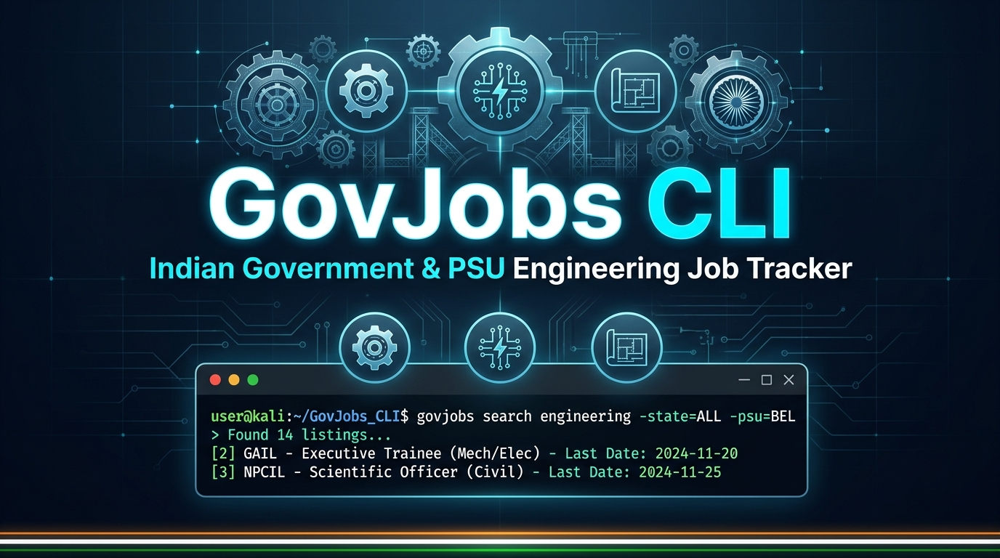
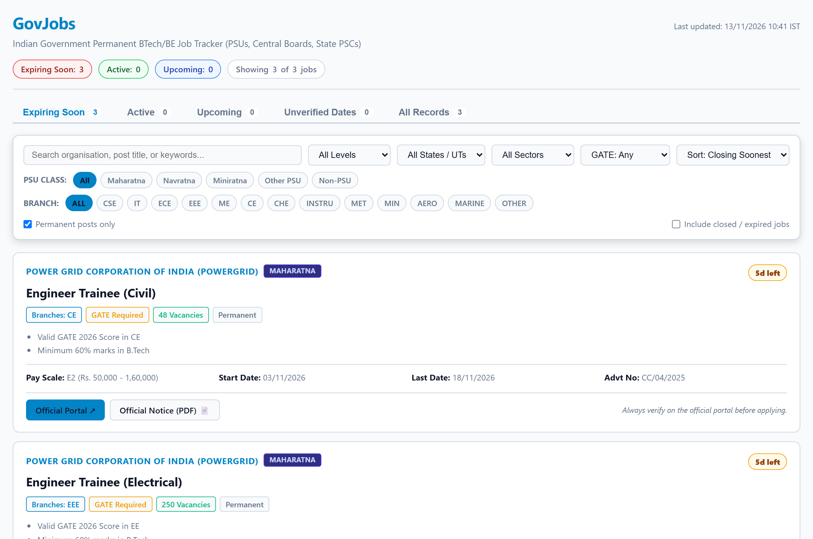

# GovJobs CLI 🇮🇳

<p align="center">
  
</p>

<p align="center">
  <b>A ₹0-cost, local-first intelligent tracker for Indian Government & PSU permanent jobs open to BTech / BE graduates.</b>
</p>

<p align="center">
  
  
  
  
  
</p>

---

## ⚡ Overview

**GovJobs CLI** is an open-source, local-first Python CLI engine tailored specifically for engineering graduates in India. It prioritizes **Central Public Sector Enterprises (CPSEs)** — covering **100% of Maharatna and Navratna PSUs**, plus Miniratna enterprises and premier recruiting commissions (SSC, DRDO, ISRO, RRB, UPSC).

Unlike commercial job aggregators filled with clickbait, stale notices, and coaching ads:
- **Direct Official Links Only**: Links directly to authentic recruiter portals (`.gov.in`, `.nic.in`, `.ac.in`, and official PSU career portals).
- **₹0 Running Cost**: No LLM API tokens, cloud subscriptions, or paid scraping proxies. The local AI agent acts as the extraction engine.
- **Offline Interactive Dashboard**: Generates a zero-network, self-contained single-file HTML app (`data/jobs.html`) with dynamic Indian Standard Time (IST) deadlines and search filters.
- **Strict Anti-Aggregator Shield**: Enforces strict URL domain validation to eliminate clone sites.
- **Polite & Ethical Scraper**: Respects recruiter servers with 2-second rate limits, honest User-Agents, and robots.txt compliance.

---

## 🖥️ Interactive Dashboard Demo

The offline dashboard (`data/jobs.html`) loads with zero external dependencies and renders real-time countdowns, status tags, search filters, and dark/light modes:

<p align="center">
  
</p>

---

## 🚀 Key Features

| Feature | Description |
|---|---|
| **PSU-First Radar** | Prioritizes Maharatna (BHEL, IOCL, ONGC, POWERGRID, NTPC, SAIL, etc.) and Navratna PSUs with automated DPE categorization. |
| **Two-Tier Engine** | Direct recruiter scrapers + a secondary discovery engine that monitors job-news feeds with 30-day auto-purge. |
| **Agentic Extraction** | Pre-task heuristics filter out admit cards, results, tenders, and menu text before generating AI tasks. |
| **Strict Date Standards** | Always parsed and stored as ISO (`YYYY-MM-DD`) and displayed to humans as `DD/MM/YYYY`. "Today" is locked to IST. |
| **No Disk PDF Hoarding** | Notices and PDFs are parsed in-memory; only structured metadata and official links are retained. |
| **Stable ID Hashing** | SHA-256 content deduplication prevents redundant entries when notices are republished. |

---

## 🛠️ CLI Command Reference

| Command | Usage | Description |
|---|---|---|
| `jobs doctor` | `jobs doctor` | Verify system health (SQLite, Playwright, PSU registry, configs, network). |
| `jobs update` | `jobs update` | Polite fetch across registered recruiter feeds and generate inbox tasks. |
| `jobs extract` | `jobs extract --limit 5` | Display next priority inbox tasks for AI extraction (Role B). |
| `jobs ingest` | `jobs ingest` | Validate and insert structured job objects into SQLite store. |
| `jobs list` | `jobs list --psu-class maharatna` | Query active jobs filtered by sector, level, branch, GATE, or PSU status. |
| `jobs show` | `jobs show <id>` | Display comprehensive details of a specific job record. |
| `jobs sources` | `jobs sources` | Check scraping health, latency, HTTP status, and red flags. |
| `jobs coverage --psu` | `jobs coverage --psu` | View CPSE coverage status across all Maharatna, Navratna, and Miniratnas. |
| `jobs psu-sync` | `jobs psu-sync` | Sync PSU master list from Wikipedia and verified DPE overrides. |
| `jobs tipoff` | `jobs tipoff` | Run discovery scanner on curated job feeds for missed opportunities. |
| `jobs tips` | `jobs tips` | List unresolved job discovery leads. |
| `jobs tip-resolve` | `jobs tip-resolve <id> --url <link>` | Resolve a lead with official recruiter URL or drop (`--drop`). |
| `jobs clean-inbox` | `jobs clean-inbox` | Purge obsolete or duplicate tasks from inbox. |
| `jobs export` | `jobs export` | Export active jobs to JSON, CSV, and the offline static HTML dashboard. |
| `jobs daily` | `jobs daily` | Run automated daily batch: fetch, tipoff discovery, and export. |

---

## 📦 Installation & Quickstart

### Prerequisites
- Python 3.11 or higher
- Git

### 1. Clone & Set Up Virtual Environment

```bash
git clone https://github.com/rahulhingve/GovtJobs.git
cd GovtJobs

# Create virtual environment
python -m venv .venv

# Activate virtual environment
# Windows (PowerShell):
.venv\Scripts\activate
# Linux/macOS:
source .venv/bin/activate

# Install in editable mode with development dependencies
pip install -e .
```

### 2. Verify System Setup

```bash
jobs doctor
```

### 3. Run Daily Pipeline

```bash
# Fetch latest updates and tipoffs
jobs daily

# View active PSU jobs
jobs list --psu-class maharatna

# Open the interactive HTML dashboard
# Windows:
start data/jobs.html
# macOS:
open data/jobs.html
# Linux:
xdg-open data/jobs.html
```

---

## 🏗️ Architecture & Processing Lifecycle

```text
[Recruiter Portals & Feeds]
            │
            ▼  (Polite fetch: robots.txt + 2s domain rate limit)
    [govjobs/fetch.py]
            │
            ▼  (Text extraction & PDF cache)
   [govjobs/classify.py] ───► [Discards Non-Recruitment (Admit Cards, Results)]
            │
            ▼  (Creates pending tasks)
       [data/inbox/]
            │
            ▼  (Agent extraction: Schema validation & date normalization)
      [data/outbox/]
            │
            ▼  (PSU metadata tagging & hash ID assignment)
     [govjobs/store.py] ───► [data/jobs.db (SQLite)]
            │
            ▼
    [govjobs/render.py] ───► [data/jobs.html (Zero-network offline dashboard)]
```

---

## 🧪 Running the Test Suite

The test suite covers HTML sanitization, PSU matching algorithms, date normalization, tipoff scrapers, and schema validation:

```bash
python -m pytest -q
```

---

## 📄 License

This project is licensed under the [MIT License](LICENSE).
